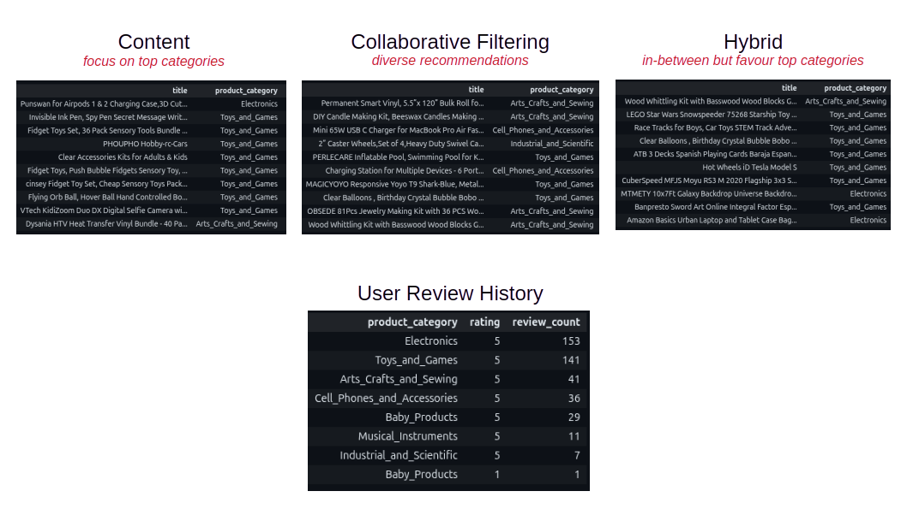
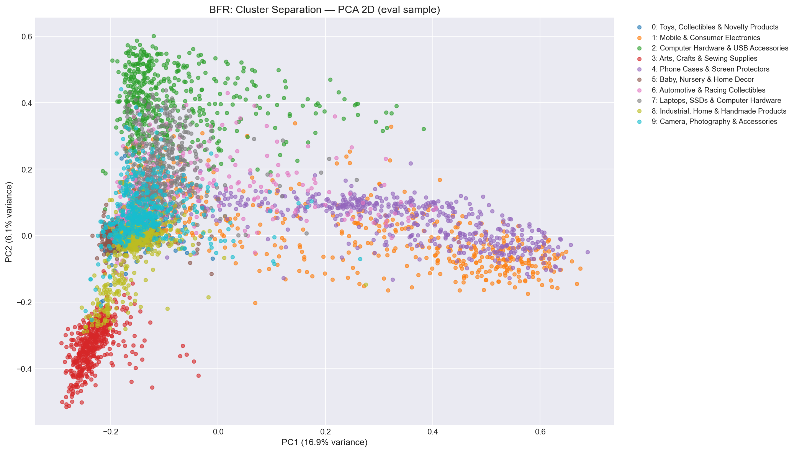

# Large-Scale Amazon Recommendation System

**End-to-end big data pipeline on Amazon Reviews 2023: database design, vector similarity search, customer and product clustering, and personalised recommendations.**

Group project (team of 5), MSc Data Science, Lancaster University (SCC.454, awarded **74%, Distinction**).

---

## The problem
An e-commerce platform needs to store and search tens of millions of products and reviews, understand different types of customers, and recommend relevant products, including to brand-new users with no history (the *cold-start* problem). We built and evaluated a full pipeline to do this at scale.

## The data
- [Amazon Reviews 2023](https://amazon-reviews-2023.github.io/) (Hou et al., 2024), 10 product categories
- **~5.7 million products**, **~105 million reviews**, **~30 million users**
- Data is streamed from Hugging Face and is **not stored in this repository**

## Pipeline

| Stage | Folder | What we did |
|---|---|---|
| **1. Database design** | `0_data_preparation` | Loaded and benchmarked **5 databases** (ClickHouse, PostgreSQL, MongoDB, ScyllaDB, Elasticsearch) on ingestion and query speed. **ClickHouse** was selected. |
| **2. Feature engineering & similarity** | `1_feature_engineer_and_vector_db_and_similarity` | Built product and user vectors (TF-IDF, embeddings) and compared vector databases (FAISS, Qdrant, Pinecone, ChromaDB, pgvector) using **HNSW** search. |
| **3. Clustering** | `2_clustering` | Segmented customers into **five behavioural personas** with Mini-Batch K-Means, and clustered **~5.7M products** with Spark K-Means and the BFR algorithm (for data too large for memory). *k* chosen by elbow and silhouette analysis. |
| **4. Recommendation** | `3_recsys` | Content-based, **ALS collaborative filtering** (PySpark, tuned with 5-fold validation), hybrid and LLM-assisted recommenders, with popularity-based fallbacks for cold-start users. Evaluated with Precision@K, Hit Rate@K, NDCG@K and Coverage@K on time-based splits. |

## Results

## My contribution (Parand Parsa)
**Product clustering (Task 3):** I designed and ran two approaches to group ~5.7 million products, both built to work with data too large to fit in memory:
- **Approach 1: Mixed vectors + Spark K-Means** (`2_clustering/product_mixedvector_sparkKmeans.ipynb`): combined semantic embeddings with numerical product attributes (387 dimensions), reduced them to 50 with PCA, and clustered with Spark K-Means (*k* = 8).
- **Approach 2: TF-IDF + BFR** (`2_clustering/product_tfidf_BFR.ipynb`): reduced 1,000-dimensional TF-IDF vectors to 50 with PCA and implemented the **BFR (Bradley-Fayyad-Reina) algorithm**, which clusters data in batches (*k* = 10).
- Chose *k* using **elbow and silhouette analysis** on a 20,000-product sample, balancing statistical fit with clusters that are meaningful for the business.

**Database comparison (Task 1):** loaded the data into **Elasticsearch** and benchmarked its ingestion and query performance against the other databases (`0_data_preparation/elasticsearch.ipynb`).

## Team
Vuong Thanh Cong (Liam), Duong Minh Hoang, Maaz Adnan, Vishal Singh, Parand Parsa.
Shared with the agreement of all team members. The original repository is hosted on Lancaster University GitLab.

## Tools
Python, PySpark (Spark SQL, MLlib), ClickHouse, PostgreSQL, MongoDB, ScyllaDB, Elasticsearch, FAISS, Qdrant, Pinecone, ChromaDB, pgvector, scikit-learn, Hugging Face Datasets

## How to run
1. Copy `.env.example` to `.env` and add your own database credentials
2. Install the packages used in each notebook (PySpark, clickhouse-connect, scikit-learn, etc.)
3. Run the notebooks in folder order: `0_` → `1_` → `2_` → `3_`

> Note: cloud database credentials have been removed from this copy. Large intermediate data files and the report draft are not included.
